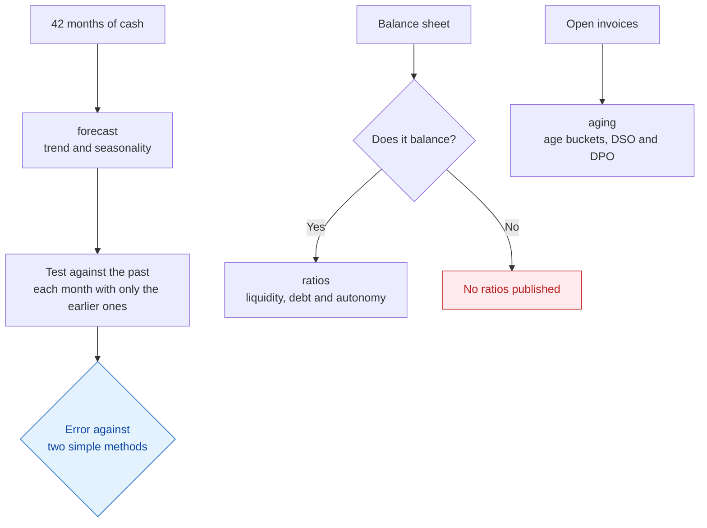

Versión en español: [README.md](README.md)

# Cash forecasting

It forecasts cash for the coming months and measures, against the past, how far that forecast is off. It also
computes balance-sheet liquidity ratios and the ageing of receivables and payables.

**Result:** one month ahead, the forecast is off by 4,334 € on average, over 18 months forecast without seeing
the actual figure. The same month of the previous year plus the trend is off by 5,082 €. The usual method, the
average of the same month in previous years, by 29,444 €.

[](https://github.com/jleonceo/tesoreria-forecast-ia/actions/workflows/ci.yml)

```bash
python probar_todo.py
```

Standard Python, nothing to install, no database and no network. It generates the sample data and runs the
three demonstrations in a couple of seconds.

## The starting problem

Many companies forecast a month's cash with the average of that same month in previous years. They rarely check
how far it is off. If the company is growing, that average lags behind the present. Purchasing, hiring and
payment decisions are then made on a figure with an unknown error.

## What is inside




1. `forecast/` splits the monthly cash series into trend and seasonality, forecasts the following months and
   tests itself against the past: for every month already known, it forecasts using only the earlier months,
   records the error and compares it with that of two simple methods.
2. `ratios/` classifies balance-sheet accounts under the Spanish chart of accounts and computes current ratio,
   quick ratio, cash ratio, working capital, leverage and financial autonomy. If the balance sheet does not tie
   out, it publishes no ratios.
3. `aging/` spreads open invoices across age buckets and computes DSO and DPO, the average days to collect and
   to pay.
4. `datos_ejemplo/` holds 42 months of invented cash data, a balance sheet and seven invoices, with the program
   that generates them.

## What comes out

The forecast is compared with two simple methods. The usual method is the average of the same month in
previous years. The demanding one takes the same month of the previous year and adds the trend of the last two
years.

| Horizon | Forecast | Same month plus trend | Usual method | Forecasts tested |
|---|---|---|---|---|
| 1 month | 4,334 € | 5,082 € | 29,444 € | 18 |
| 3 months | 8,374 € | 9,335 € | 87,797 € | 16 |
| 12 months | 23,985 € | 18,617 € | 346,619 € | 7 |

At three and twelve months, the error is that of the sum of the months in the horizon. At one and three months
the forecast beats both methods. At twelve months it loses to the same month plus the trend.

- **Last six months tested:** the forecast beats the usual method in all six and the same month plus the trend
  in two.
- **Sample balance sheet:** ties out to 0.00; current ratio 1.94 and quick ratio 1.17.
- **Open invoices:** 40,000 €, of which 22,000 € are overdue; DSO of 60.8 days.

To compare companies of different size, the error is also given as MASE, which divides it by the typical
variation of the series itself: 0.26 for the forecast and 1.73 for the usual method, one month ahead. Lower is
better.

## Limits

- The data is synthetic and was generated with the same shape the model assumes: a steady climb, the same
  pattern each month of the year and moderate noise. It shows the calculation works, not that it would be
  right for a real company that loses a customer or delays a project.
- Most of the advantage over the usual method comes from the series growing by about 1,500 € a month, which
  that method does not see. Against the same month plus the trend, the gain one month ahead is 748 €.
- The twelve-month figure comes from only seven forecasts.
- Two years of monthly history are needed before the first forecast.
- The sample DSO assumes annual sales of 240,000 € fixed in the code.
- The automated tests redo the backtesting, the error scale and the ratios by a second route. They were checked to fail
  by planting twelve errors on purpose, one at a time. They do not say whether another model would do better.
- [caso_real.md](caso_real.md) records a test on real data that failed: adding invoices already issued, with
  their due dates, made the forecast worse. Those figures cannot be reproduced with the sample data.

## Data

Everything is synthetic and comes out the same on every run, with seed 20260713. There is no real or personal
data.

## Related repositories

- [analisis-contable](https://github.com/jleonceo/analisis-contable): 2024 income statement and cash with
  pandas, checked by a second route.
- [control-interno-fraude-ia](https://github.com/jleonceo/control-interno-fraude-ia): fraud tests on the
  general ledger.
- [de-datos-en-bruto-a-decisiones](https://github.com/jleonceo/de-datos-en-bruto-a-decisiones): a raw sales file
  turned into business answers and a dashboard.

---

*Part of [Juan Luis León](https://github.com/jleonceo)'s portfolio · [juanluisleon.vercel.app](https://juanluisleon.vercel.app) · Licence [MIT](LICENSE)*
