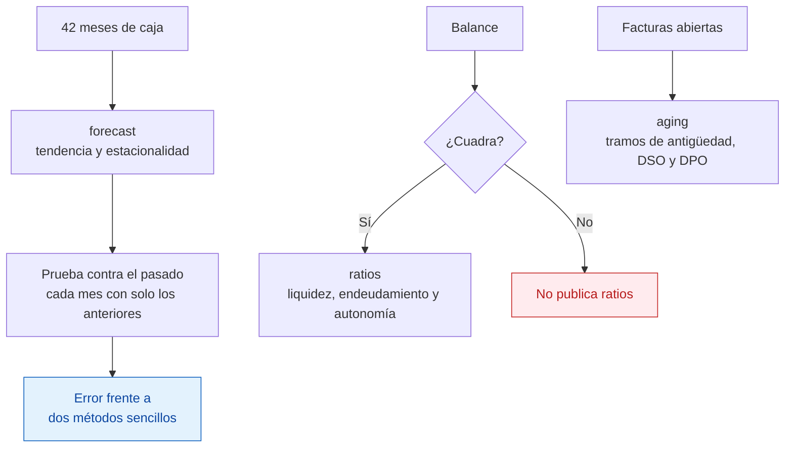

English version: [README.en.md](README.en.md)

# Previsión de tesorería

Prevé la caja de los próximos meses y mide, contra el pasado, cuánto se equivoca esa previsión. Incluye
también los ratios de liquidez del balance y la antigüedad de lo pendiente de cobro y de pago.

**Resultado:** a un mes vista, la previsión se equivoca de media en 4.334 €, en 18 meses previstos sin ver el
dato real. El mismo mes del año anterior más la tendencia se equivoca en 5.082 €. El método habitual, la media
del mismo mes en años anteriores, en 29.444 €.

[](https://github.com/jleonceo/tesoreria-forecast-ia/actions/workflows/ci.yml)

```bash
python probar_todo.py
```

Python estándar, sin nada que instalar, sin base de datos y sin red. Genera los datos de ejemplo y ejecuta las
tres demostraciones en un par de segundos.

## El problema de partida

Muchas empresas prevén la caja de un mes con la media de ese mismo mes en los años anteriores. Casi nunca
comprueban cuánto falla. Si la empresa crece, esa media va por detrás del presente. Las decisiones de compras,
contratación o aplazamientos se toman entonces sobre una cifra con error desconocido.

## Qué hay dentro




1. `forecast/` separa la serie mensual de caja en tendencia y estacionalidad, prevé los meses siguientes y se
   examina contra el pasado: para cada mes ya conocido, prevé usando solo los meses anteriores, anota el
   error y lo compara con el de dos métodos sencillos.
2. `ratios/` clasifica las cuentas del balance según el Plan General Contable y calcula ratio corriente,
   prueba ácida, ratio de caja, fondo de maniobra, endeudamiento y autonomía financiera. Si el balance no
   cuadra, no publica ratios.
3. `aging/` reparte las facturas abiertas por tramos de antigüedad y calcula el DSO y el DPO, los días medios
   de cobro y de pago.
4. `datos_ejemplo/` contiene 42 meses de caja inventados, un balance y siete facturas, con el programa que los
   genera.

## Lo que sale

La previsión se compara con dos métodos sencillos. El método habitual es la media del mismo mes en años
anteriores. El exigente toma el mismo mes del año anterior y le suma la tendencia de los dos últimos años.

| Horizonte | Previsión | Mismo mes más tendencia | Método habitual | Previsiones examinadas |
|---|---|---|---|---|
| 1 mes | 4.334 € | 5.082 € | 29.444 € | 18 |
| 3 meses | 8.374 € | 9.335 € | 87.797 € | 16 |
| 12 meses | 23.985 € | 18.617 € | 346.619 € | 7 |

A tres y a doce meses, el error es el de la suma de los meses del horizonte. A uno y a tres meses la previsión
gana a los dos métodos. A doce meses pierde frente al mismo mes más la tendencia.

- **Últimos seis meses examinados:** la previsión gana al método habitual en los seis y al mismo mes más la
  tendencia en dos.
- **Balance de ejemplo:** cuadra a 0,00; ratio corriente 1,94 y prueba ácida 1,17.
- **Facturas abiertas:** 40.000 €, de los que 22.000 € están vencidos; DSO de 60,8 días.

Para comparar empresas de distinto tamaño, el error también se da como MASE, que lo divide entre la variación
típica de la propia serie: 0,26 la previsión y 1,73 el método habitual, a un mes. Cuanto más bajo, mejor.

## Límites

- Los datos son sintéticos y se generaron con la misma forma que supone el modelo: una subida constante, el
  mismo patrón cada mes del año y un ruido moderado. Demuestra que el cálculo funciona, no que acierte con una
  empresa real que pierde un cliente o retrasa una obra.
- La mayor parte de la ventaja frente al método habitual sale de que la serie crece unos 1.500 € al mes y ese
  método no lo ve. Frente al mismo mes más la tendencia, la mejora a un mes es de 748 €.
- La cifra a 12 meses sale de solo siete previsiones.
- Hacen falta dos años de historia mensual antes de la primera previsión.
- El DSO de ejemplo supone unas ventas anuales de 240.000 € fijadas en el código.
- Las pruebas automáticas rehacen por otro camino el backtesting, la escala del error y los ratios. Se comprobó que
  fallan metiendo doce errores a propósito, uno cada vez. No dicen si otro modelo acertaría más.
- [caso_real.md](caso_real.md) recoge una prueba con datos reales que salió mal: añadir los vencimientos ya
  facturados empeoró la previsión. Esas cifras no se pueden reproducir con los datos de ejemplo.

## Datos

Todo es sintético y sale igual en cada ejecución, con la semilla 20260713. No hay datos reales ni personales.

## Repositorios relacionados

- [analisis-contable](https://github.com/jleonceo/analisis-contable): cuenta de resultados y tesorería de 2024
  con pandas, comprobadas por un segundo camino.
- [control-interno-fraude-ia](https://github.com/jleonceo/control-interno-fraude-ia): pruebas de fraude sobre el
  libro diario.
- [de-datos-en-bruto-a-decisiones](https://github.com/jleonceo/de-datos-en-bruto-a-decisiones): un fichero de
  ventas en bruto convertido en respuestas de negocio y en un cuadro de mando.

---

*Parte del portfolio de [Juan Luis León](https://github.com/jleonceo) · [juanluisleon.vercel.app](https://juanluisleon.vercel.app) · Licencia [MIT](LICENSE)*
